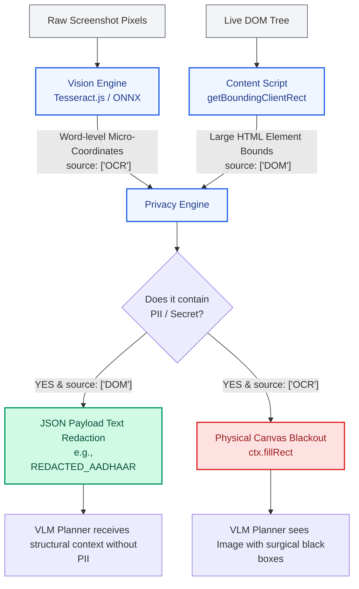

# Privacy Engine Architecture Schematic

This schematic illustrates our dual-layered approach to Redaction. It perfectly visualizes how we solve the "DOM Spillage" problem while retaining perfect spatial accuracy for the VLM planner.

### How to Explain This to the Juries:

1. **The Left Side (OCR/Vision):** Explain that standard DOM scraping is flawed because HTML wrappers (`
`, `
`) are often much larger than the sensitive text itself. If we just blacked out DOM coordinates, we would destroy safe surrounding context ("DOM Spillage").
2. **The OCR Intercept:** To fix this, we run a local, offline OCR pass directly on the image pixels. The OCR engine finds the exact `X,Y` coordinates of *just* the 12 digits of the Aadhaar number.
3. **The Split Execution:**
    *   The **DOM** is used to sanitize the raw text being sent to the LLM (replacing the string).
    *   The **OCR** is strictly used to paint the physical black boxes on the screenshot, ensuring surgical, pixel-perfect visual redaction that never hides safe data from the AI.
