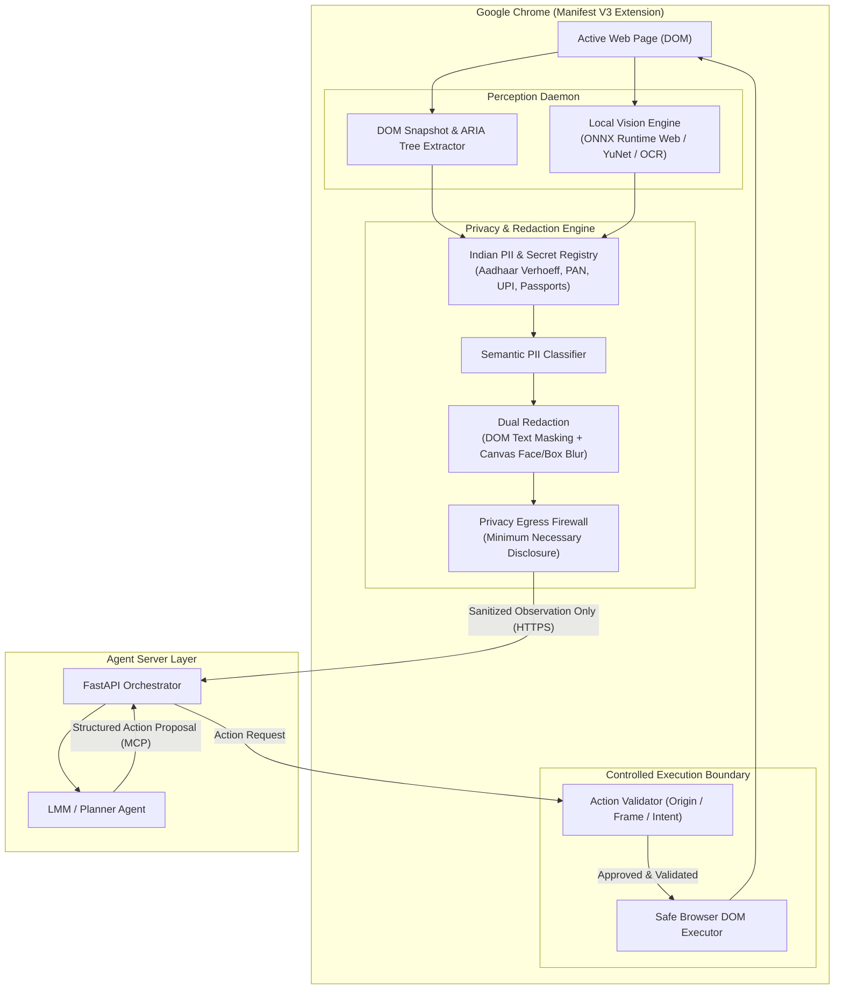

# Nexus 🛡️🌐

> **On-Device Visual Perception, Privacy-Preserving Redaction & Controlled Execution for Lightweight Browser Agents**  
> *Developed for Smart India Hackathon (SIH) — Problem Statement 26171 (ISRO)*

[](https://www.typescriptlang.org/)
[](https://developer.chrome.com/docs/extensions/mv3/)
[](https://onnxruntime.ai/)
[](https://fastapi.tiangolo.com/)
[](https://react.dev/)
[](https://vitest.dev/)

---

## 📖 Overview

**Nexus** is a privacy-first browser agent perception and execution engine. Modern Autonomous AI web agents often pose critical security risks by transmitting raw screenshots, authentication tokens, and sensitive Personal Identifiable Information (PII) directly to remote cloud Large Multimodal Models (LMMs).

Nexus solves this by implementing an **On-Device Perception, Privacy Firewall, and Controlled Action Boundary** running locally inside Google Chrome (Manifest V3):

1. **Zero Data Leakage**: Sensitive identity tokens, passwords, and Indian government identifiers (Aadhaar, PAN, UPI, Voter ID, Passport) are detected, classified, and redacted **on-device** before any data egresses the browser.
2. **On-Device Computer Vision**: Runs lightweight neural models (YuNet face detection via ONNX Runtime Web with WebGPU/WASM acceleration) directly in offscreen browser documents to blur human faces and visual credentials on captured canvas screenshots.
3. **DOM & ARIA-First Structural Grounding**: Extracts a high-fidelity, accessibility-aligned semantic representation of the page, avoiding heavy screenshot-only token costs.
4. **Controlled Action Execution**: Enforces a strict, sandboxed **Action Validator** conforming to the Model Context Protocol (MCP) to prevent prompt-injection attacks, unauthorized financial transactions, and unintended page state mutations.

---

## 🏛️ System Architecture



---

## ✨ Key Features

### 1. 🔍 On-Device Multi-Modal Perception
- **DOM & ARIA-First Tree Generation**: Builds an accurate interactive accessibility tree using `dom-accessibility-api`, assigning unique numeric action references to interactive elements.
- **Local Vision with ONNX Runtime Web**: Uses on-device inference via **WebGPU**, **WebGL**, or **WASM** fallback for zero-cloud-latency computer vision.
- **Face Detection & Blurring**: Integrates the lightweight **YuNet ONNX** model to accurately locate and censor faces in viewport screenshots.
- **On-Device OCR**: Extracts text from visual elements with Tesseract.js when pure DOM nodes are obstructed.

### 2. 🛡️ Comprehensive Indian PII & Secret Redaction
- **Aadhaar Detection**: Verhoeff algorithm checksum validation to reject random 12-digit numbers while redacting genuine Aadhaar IDs.
- **PAN Verification**: Strict structural and IT-department regex pattern matching.
- **Financial & Identity Markers**: UPI IDs (`username@bank`), Indian Phone Numbers (`+91`), IFSC codes, Passport numbers, Voter ID (EPIC), Driving Licenses, and Credit Card numbers (Luhn checksum).
- **Credentials & API Tokens**: Automatic scrubbing of Bearer tokens, JWTs, AWS/GCP access keys, private keys, and password fields.

### 3. 🚦 Minimum Necessary Disclosure & Egress Audit Gate
- Enforces a firewall ensuring that neither raw DOM trees nor unmasked visual pixels can leave the client boundary.
- **Egress Audit Adapter**: An independent, non-blocking auditing interface that logs sanitized egress events for regulatory compliance.

### 4. 🔒 Model Context Protocol (MCP) Action Boundary
- Decouples untrusted remote agent decisions from local execution.
- Validates target element coordinates, origins, frame ancestry, and interaction types.
- Blocks destructive operations (e.g., unauthorized funds transfer, credential export, hidden iframe navigation) before execution.

---

## 📂 Repository Structure

```text
.
├── contracts/               # Shared TypeScript schemas, action interfaces & validator contracts
│   └── ts/                  # Core action schemas, validators, and MCP interfaces
├── extension/               # Chrome Extension (Manifest V3) powered by WXT & React
│   ├── entrypoints/         # Extension entrypoints (sidepanel, content-scripts, background)
│   ├── src/
│   │   ├── background/      # Service worker, perception daemon & privacy controller
│   │   ├── network/         # Privacy egress gate and Egress Audit Adapter
│   │   ├── privacy/         # Indian PII detectors, Verhoeff validator, semantic classifier
│   │   ├── vision/          # ONNX Runtime Web engine, YuNet face detector, canvas blur
│   │   └── ui/              # Sidepanel React UI dashboard
│   └── wxt.config.ts        # WXT configuration
├── server/                  # Backend Agent & Planner Server
│   └── app/                 # FastAPI server, context processor & LMM integration
├── test-site/               # Local test web application for PII and interaction testing
├── tests/                   # Test suite
│   └── unit/                # Vitest unit & integration test suites (PII, Vision, MCP, Egress)
├── md_files/                # Architectural reports, phase deliverables, and technical documentation
└── vitest.config.ts         # Vitest configuration
```

---

## 🚀 Getting Started

### Prerequisites
- **Node.js** `>= 18.0.0`
- **pnpm** `>= 8.0.0`
- **Python** `>= 3.10` (for FastAPI agent backend)
- **Google Chrome** (v115+ recommended for WebGPU support)

### Installation

1. **Clone the repository:**
   ```bash
   git clone https://github.com/rishis04/Nexus_rishi.git
   cd Nexus_rishi
   ```

2. **Install frontend & extension dependencies:**
   ```bash
   pnpm install
   ```

3. **Install backend server dependencies:**
   ```bash
   cd server
   python3 -m venv .venv
   source .venv/bin/activate
   pip install -r requirements.txt
   cd ..
   ```

---

## 🛠️ Building & Running

### 1. Build the Chrome Extension
Compile the Manifest V3 extension:
```bash
pnpm build
```
The compiled, production-ready extension is located at:
```
extension/.output/chrome-mv3
```

### 2. Load Extension in Google Chrome
1. Open Google Chrome and navigate to `chrome://extensions/`.
2. Toggle on **Developer mode** (top-right corner).
3. Click **Load unpacked**.
4. Select the build directory:
   ```
   <PATH_TO_PROJECT>/extension/.output/chrome-mv3
   ```
5. Click on the extension icon in Chrome toolbar to open the **Nexus Side Panel**.

### 3. Start the Agent Backend Server
```bash
cd server
source .venv/bin/activate
uvicorn app.main:app --host 127.0.0.1 --port 8000 --reload
```

### 4. Start the Test Environment (Optional)
Run the built-in PII and form testing website:
```bash
pnpm dev:site
```

---

## 🧪 Testing

The repository includes a comprehensive unit and integration test suite:

```bash
# Run all unit and integration tests with Vitest
pnpm test

# Run tests in watch mode
pnpm test:watch

# Run Playwright End-to-End browser tests
pnpm e2e
```

### Test Coverage Highlights:
- **`phase4-indian-pii-detectors.test.ts`**: Verhoeff checksum validation, PAN formatting, Voter ID, and phone number edge cases.
- **`phase3-semantic-pii-classifier.test.ts`**: Semantic classification of sensitive fields.
- **`phase5-dom-masking-integration.test.ts`**: End-to-end DOM tree redaction.
- **`controlled-execution-boundary.test.ts`**: Origin checks, dangerous action blocking, and frame isolation.
- **`egress-audit-adapter.test.ts`**: Zero-data-leakage egress firewall verification.

---

## 🧰 Technology Stack

| Layer | Technologies |
|---|---|
| **Extension Framework** | [WXT](https://wxt.dev/), Manifest V3, TypeScript 5.8 |
| **Extension Frontend** | React 18, Vite |
| **On-Device AI / Vision**| [ONNX Runtime Web](https://onnxruntime.ai/) (WebGPU/WASM), YuNet, Tesseract.js |
| **Accessibility Engine** | `dom-accessibility-api` |
| **Agent Server** | FastAPI, Uvicorn, Pydantic |
| **Contracts & Validation**| Zod, Custom Verhoeff Checksum, Luhn Algorithm |
| **Testing** | Vitest, Happy-DOM, Playwright |

---

## 📄 License & Attribution

Developed for the **Smart India Hackathon (SIH)** under Problem Statement **26171** (ISRO).  
Distributed under the MIT License. See [LICENSE](LICENSE) for details.
