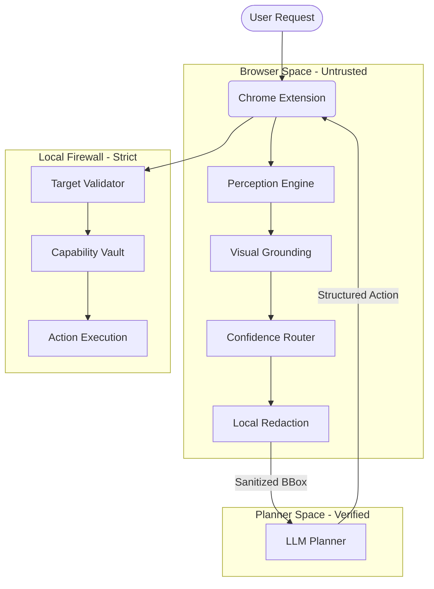

# Architecture Overview

The Antigravity system is a secure, local-first agent framework that bridges visual perception, structured planning, and verifiable action execution within a Zero-Trust architecture. 

## High-Level Block Diagram

## Core Components

### 1. Perception Fusion
We combine traditional DOM & ARIA trees with advanced Local Vision (ONNX Runtime Web, YOLO-based UI Component Detection, and Tesseract OCR). This provides a unified `PerceptionContract` even on opaque canvas elements like ISRO Bhuvan maps.

### 2. Confidence Router
The system dynamically selects the fastest, most reliable perception method based on the `target_region` and the application's complexity. A standard HTML form may route purely via DOM, whereas a spatial rendering engine will engage the WebGPU vision stack.

### 3. Visual Grounding
Every element detected is mapped back to physical screen space (`BBox`). Bounding boxes are strictly utilized to prevent DOM spoofing and ensure that coordinates correlate strictly with what is visibly rendered to the user.

### 4. Zero-Trust Local Firewall
The LLM Planner is completely unprivileged. When the planner issues a `StructuredAction`, the Extension initiates a strict gauntlet:
- **State Fingerprinting**: Ensures the page hasn't drifted since perception (SHA-256).
- **Target Validator**: Checks for occlusion, zero-opacity, and off-screen coordinates to defend against Clickjacking.
- **Capability Vault**: Retrieves AES-GCM encrypted passwords purely via local authorization, preventing raw credential leakage to the LLM.
- **Debugger Dispatch**: Uses native `Input` CDP commands to bypass anti-automation filters and synthesize `isTrusted: true` hardware events.
